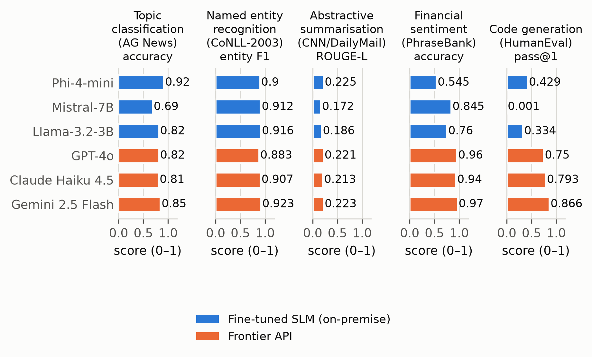

# Fine-Tune or Pay Per Token?

An enterprise benchmark comparing **three fine-tuned small language models** with **three hosted language model APIs** across five NLP tasks, with a Streamlit decision tool for exploring quality, latency, cost, and deployment constraints.

[Decision tool](https://slm-benchmark-iqwxhymearqtuw7rr6mdmt.streamlit.app/) · [Benchmark data](results/benchmark_matrix.csv) · [Methodology](docs/METHODOLOGY.md) · [Audit and limitations](docs/thesis_corrections.md)

## What this project investigates

When does adapting a smaller model make sense compared with using an API? This repository brings together LoRA/QLoRA training, task evaluation, API baseline notebooks, MLflow experiment records, and cost analysis. The application reads recorded results; it does **not** run live model inference.

| Component | Coverage |
| --- | --- |
| Fine-tuned models | Llama 3.2 3B Instruct, Mistral 7B v0.3, Phi-4-mini Instruct |
| API baselines | GPT-4o, Claude Haiku 4.5, Gemini 2.5 Flash |
| Tasks | News classification, named entity recognition, summarization, financial sentiment, code generation |
| Training | LoRA / QLoRA configurations, task-specific adapters, MLflow logging |
| Analysis | Task scores, latency, per-request cost, significance analysis, and decision recommendations |

## Recorded results at a glance

The following classification rows are taken from the committed [benchmark matrix](results/benchmark_matrix.csv). These are recorded experimental results, not independently reproduced measurements or universal model rankings.

| Model | Method | Classification accuracy | Recorded mean latency |
| --- | --- | ---: | ---: |
| Phi-4-mini Instruct | LoRA | 92% | 161.77 ms |
| Gemini 2.5 Flash | API | 85% | 936.22 ms |
| Llama 3.2 3B Instruct | LoRA | 82% | 459.50 ms |
| GPT-4o | API | 82% | 913.69 ms |
| Claude Haiku 4.5 | API | 81% | 923.21 ms |
| Mistral 7B v0.3 | QLoRA | 69% | 555.93 ms |

API classification rows contain 100 examples each. Hardware, network conditions, sample sizes, and decoding settings affect comparisons. The matrix's `accuracy` column is a generic score field: NER, summarization, and code generation use different metrics, so scores must be interpreted within each task.



## Run the decision tool locally

The dashboard needs only the lightweight application dependencies and the committed result files; no GPU or provider API key is required.

```bash
git clone https://github.com/Yusifnuri/slm-benchmark.git
cd slm-benchmark
python -m venv .venv
source .venv/bin/activate
# Windows PowerShell: .venv\Scripts\Activate.ps1
python -m pip install -r requirements-app.txt
python -m streamlit run app.py
```

Choose a task, quality threshold, monthly token volume, and whether data must remain on-premise. Recommendations reflect the stored measurements and the framework's assumptions. Review the cost caveats below before using them for a deployment decision.

## Research workflow

Run commands from the repository root. The full research stack is separate from the dashboard environment.

### 1. Install the research dependencies

```bash
python -m pip install -r requirements.txt
```

GPU training uses the CUDA-compatible PyTorch / bitsandbytes stack. Select a compatible environment for the model and configuration you intend to run. Access to gated model weights requires the model provider's permission and Hugging Face authentication.

### 2. Prepare data and inspect the loading paths

```bash
python scripts/prepare_financial_data.py
python tests/test_local_cpu.py
```

The preparation script creates `data/financial_phrasebank.csv`. The CPU smoke script checks selected dataset-loading paths and metric utilities; it downloads data and is not a full training or evaluation run.

### 3. Fine-tune a model

```bash
python src/training/train_lora.py   --config configs/llama_lora.yaml   --task classification
```

For the complete training/evaluation sweep, inspect `scripts/run_all_experiments.py` before running it. It performs up to 15 model/task runs and skips training when an adapter directory already exists. Use a separate checkout or deliberately manage existing adapters when reproducing training; existing artifacts do not prove that a fresh run completed.

### 4. API baselines and analysis

The baseline notebooks are under `notebooks/02`–`06`. Copy `.env.example` to `.env` and supply your own provider keys. These notebooks make billable API calls. Their imports also require the relevant provider SDKs (`openai`, `anthropic`, `google-generativeai`) and a notebook environment; these are not all listed in the research requirements file.

The `results/` scripts aggregate logs and MLflow records, estimate request costs, and produce figures. Read each script's inputs before regenerating committed artifacts. See [release notes](docs/RELEASE.md) for the separate Streamlit deployment branch and adapter publication workflow.

## Methodology and interpretation

- **Training and final evaluation are separated.** AG News uses a seeded validation split from training data. Financial PhraseBank uses a seeded 80/10/10 split. Code-generation fine-tuning uses MBPP; HumanEval is reserved for final evaluation.
- **Financial sentiment has an open comparability limitation.** API baselines use AllAgree while fine-tuned models use 50Agree. The resulting scores are not a matched-corpus comparison; resolving this requires rerunning experiments.
- **Cost units matter.** API blended cost per total token and self-hosted cost per generated token are different denominators. Use the per-request analysis in `results/cost_per_request.py` and its assumptions when interpreting economics. The dashboard's token-based projections are exploratory.
- **Pricing and hardware assumptions are snapshots.** They are recorded in code/configuration and need updating for a new deployment, especially when utilization changes.
- **Code-generation evaluation executes generated programs.** Run it only in an isolated, disposable environment. A subprocess timeout does not provide a security sandbox.
- **Recorded results have an audit trail.** [Methodology notes](docs/METHODOLOGY.md), [correction log](docs/thesis_corrections.md), and [artifact gaps](docs/thesis_artefact_gaps.md) preserve corrections and outstanding limitations.

## Repository map

```text
app.py                 Streamlit interface
src/decision_framework.py  Shared recommendation logic
src/data/              Dataset loading and task definitions
src/training/          LoRA and QLoRA training
src/evaluation/        Task evaluation and metrics
configs/               Model and training configurations
notebooks/             API baseline experiments
scripts/               Preparation, experiment sweep, validation, publication
adapters/              Task-specific adapters and model cards
logs/                  Recorded baseline outputs
results/               Benchmark tables, analysis scripts, and figures
tests/                 Local CPU smoke script
docs/                  Methodology, audits, and release instructions
```

## License

Source code is provided under the [MIT license](LICENSE). Model and dataset licenses remain separate. Financial PhraseBank-derived adapters carry non-commercial research restrictions; consult their model cards before reuse.
